# 毕业生信息招聘平台

> 🎓 **计算机毕业设计 · 毕业生信息招聘平台**
>
> 本仓库只放**项目介绍 + 运行截图**（截图是站点带水印的原图，存在仓库 `images/` 里）。
>
> 👉 **完整可运行源码 / 数据库脚本 / 部署文档：[点我获取](https://geekcode.top/archives/%E6%AF%95%E4%B8%9A%E7%94%9F%E4%BF%A1%E6%81%AF%E6%8B%9B%E8%81%98%E5%B9%B3%E5%8F%B0?utm_source=github)**
>
> 💬 咨询微信：**ir9372**　|　🌐 更多项目：[极客代码 geekcode.top](https://geekcode.top/?utm_source=github)
>
> 📌 项目详情页：<https://geekcode.top/archives/%E6%AF%95%E4%B8%9A%E7%94%9F%E4%BF%A1%E6%81%AF%E6%8B%9B%E8%81%98%E5%B9%B3%E5%8F%B0?utm_source=github>

<table><td width="230" align="center"> <b>扫码加微信 ir9372</b></td><td valign="middle">📦 源码 = 项目介绍 + 全部运行截图 + 数据库 + 部署文档 👉 点上方任意截图，直接跳到 <b>极客代码 geekcode.top</b> 详情页</td></table>

---

<h1>毕业生信息招聘平台</h1>
<h2>项目概述</h2>

本项目为“毕业生信息招聘平台”，旨在构建一个集校园招聘、在线求职、职业测评及互动交流于一体的综合性服务系统。针对应届毕业生就业难与企业招聘效率低下的痛点，平台提供空中宣讲会、招聘岗位发布、求职信息管理、论坛交流及在线试卷考试等核心功能。适用人群包括高校毕业生、企业招聘人员及系统管理员。技术架构采用前后端分离模式，后端基于 Spring Boot 框架结合 MyBatis-Plus 进行数据持久化，使用 Shiro 实现安全权限控制；前端基于 Vue 框架构建用户界面。该系统有效连接供需双方，通过数字化手段提升招聘流程的透明度与便捷性。

<h2>技术架构</h2>

本项目采用经典的前后端分离架构设计，确保系统的高内聚低耦合。

<strong>1. 后端架构</strong>

<ul>
<li><strong>核心框架</strong>：选用 Spring Boot 作为基础开发框架，利用其自动配置特性快速搭建 RESTful API 服务。</li>
<li><strong>数据持久层</strong>：集成 MyBatis-Plus，简化 CRUD 操作，提高数据库交互效率。底层数据库采用 MySQL 存储业务数据。</li>
<li><strong>安全认证</strong>：引入 Apache Shiro 框架，负责系统的身份验证、授权管理及会话控制，保障接口访问安全性。</li>
<li><strong>其他依赖</strong>：使用 commons-lang3 处理通用工具逻辑，validation-api 进行参数校验，protobuf-java 支持高效数据传输序列化。</li>
</ul>

<strong>2. 前端架构</strong>

<ul>
<li><strong>技术栈</strong>：采用 Vue.js 构建单页面应用（SPA），实现前台用户端与后台管理端的界面渲染。</li>
<li><strong>通信机制</strong>：前端通过 HTTP 请求与后端 Controller 层进行数据交互，遵循 JSON 数据格式规范。</li>
</ul>

<strong>3. 数据库设计要点</strong>

<ul>
<li>数据库表结构涵盖毕业生信息、企业信息、岗位详情、面试记录、试题库、论坛帖子及评论等核心实体。</li>
<li>各实体间通过外键关联，如“岗位应聘”表关联“毕业生”与“招聘岗位”，“考试记录”关联“试卷”与“毕业生”，确保数据的一致性与完整性。</li>
</ul>
<h2>功能模块</h2>

根据源码路由及截图分析，系统分为前台用户端和后台管理端两大模块。

<h3>前台用户端</h3>

<strong>1. 首页与信息展示</strong>

<ul>
<li><strong>空中宣讲会</strong>：展示线上宣讲活动列表及详情，支持查看活动简介。</li>
<li><strong>招聘岗位</strong>：浏览企业发布的职位信息，包含岗位详情及薪资要求。</li>
<li><strong>求职信息</strong>：查看毕业生发布的求职意向及简历摘要。</li>
<li><strong>招聘资讯</strong>：阅读行业动态及招聘相关新闻。</li>
<li><strong>论坛信息</strong>：参与职场话题讨论，查看帖子列表及详细内容。</li>
</ul>

<strong>2. 个人中心</strong>

<ul>
<li><strong>我的发布</strong>：管理用户自己发布的求职信息或简历内容。</li>
<li><strong>我的收藏</strong>：查看收藏的岗位、文章或宣讲会信息。</li>
<li><strong>考试记录</strong>：查询历史在线考试的得分及状态。</li>
<li><strong>错题本</strong>：复习考试中做错的题目，辅助查漏补缺。</li>
</ul>

<strong>3. 互动与应聘</strong>

<ul>
<li><strong>评论功能</strong>：支持对空中宣讲会、招聘岗位、求职信息及论坛帖子进行评论互动。</li>
<li><strong>岗位应聘</strong>：发起应聘申请，查看应聘进度。</li>
<li><strong>个人简历</strong>：在线编辑和管理个人履历信息。</li>
</ul>

<strong>4. 在线测评</strong>

<ul>
<li><strong>试卷列表</strong>：选择并进入在线考试试卷。</li>
<li><strong>考试执行</strong>：完成试题作答，提交后生成成绩。</li>
</ul>
<h3>后台管理端</h3>

<strong>1. 基础数据管理</strong>

<ul>
<li><strong>毕业生管理</strong>：维护毕业生账号及基本信息。</li>
<li><strong>企业管理</strong>：审核及管理入驻企业的资料。</li>
<li><strong>管理员管理</strong>：配置后台操作人员权限。</li>
</ul>

<strong>2. 业务内容管理</strong>

<ul>
<li><strong>招聘岗位管理</strong>：发布、修改、下架岗位信息。</li>
<li><strong>求职信息管理</strong>：审核学生提交的求职意向。</li>
<li><strong>空中宣讲会管理</strong>：创建和维护线上宣讲活动。</li>
<li><strong>招聘资讯管理</strong>：发布行业新闻及政策信息。</li>
<li><strong>信息咨询管理</strong>：回复用户关于招聘政策的咨询提问。</li>
</ul>

<strong>3. 互动社区管理</strong>

<ul>
<li><strong>论坛管理</strong>：监控论坛帖子，处理违规内容。</li>
<li><strong>评论管理</strong>：审核或删除针对岗位、宣讲会、求职信息的恶意或不实评论。</li>
</ul>

<strong>4. 考试与测评管理</strong>

<ul>
<li><strong>试卷管理</strong>：创建、编辑考试题库中的试卷。</li>
<li><strong>试题管理</strong>：维护单选、多选等具体题目内容。</li>
<li><strong>考试记录管理</strong>：查看所有用户的考试成绩明细。</li>
<li><strong>错题本管理</strong>：统计高频错题，优化题库质量。</li>
</ul>

<strong>5. 招聘流程管理</strong>

<ul>
<li><strong>岗位应聘管理</strong>：处理毕业生的应聘申请，更新状态。</li>
<li><strong>线上面试管理</strong>：安排及记录线上面试环节。</li>
<li><strong>面试回复管理</strong>：反馈面试结果给求职者。</li>
<li><strong>我的收藏管理</strong>：后台视角查看全站收藏数据分布。</li>
</ul>
<h2>用户角色与权限</h2>

系统主要涉及三类角色，依据代码中的控制器（Controller）及路由定义，权限划分如下：

<strong>1. 毕业生用户 (Student/User)</strong>

<ul>
<li><strong>注册/登录</strong>：拥有独立账号体系。</li>
<li><strong>浏览权限</strong>：可访问前台所有公开信息，包括空中宣讲会、招聘岗位、求职信息、论坛、招聘资讯及试卷列表。</li>
<li><strong>操作权限</strong>：</li>
<li>发布与管理自己的“求职信息”和“个人简历”。</li>
<li>发起“岗位应聘”。</li>
<li>参与“论坛信息”发帖及对所有业务模块（宣讲会、岗位、求职、论坛）进行“评论”。</li>
<li>执行在线“考试”，查看“考试记录”和“错题本”。</li>
<li>管理“我的收藏”。</li>
<li>查看“线上面试”通知及“面试回复”。</li>
</ul>

<strong>2. 企业用户 (Enterprise)</strong>

<ul>
<li><strong>注</strong>：虽然后台有 <code>/qiye</code> 路由且存在 <code>GangweiyingpinController</code>（岗位应聘），但根据提供的 Controller 列表（主要为 Biyesheng, Common, Config, Discuss..., Exam..., File, Forum, Gangweiyingpin 等），未明确列出独立的 EnterpriseController 用于企业自助管理。通常在此类毕设系统中，若未明确区分企业端接口，企业可能通过管理员代为录入或由具备特定权限的管理员账户操作。若系统严格区分，企业角色应能：</li>
<li>发布和管理“招聘岗位”。</li>
<li>查看收到的“岗位应聘”列表。</li>
<li>安排“线上面试”并填写“面试回复”。</li>
<li>管理“空中宣讲会”。</li>
<li><em>(基于现有代码上下文，若无专门的企业Controller，此部分功能可能由管理员在后台统一代管，或通过Shiro角色标识复用部分接口)</em></li>
</ul>

<strong>3. 系统管理员 (Admin)</strong>

<ul>
<li><strong>全量管理权限</strong>：拥有后台所有路由的访问权。</li>
<li><strong>具体职责</strong>：</li>
<li><strong>用户管理</strong>：增删改查“毕业生”、“企业”、“管理员”信息。</li>
<li><strong>内容审核</strong>：管理“招聘岗位”、“求职信息”、“空中宣讲会”、“招聘资讯”、“论坛信息”及其对应的“评论”。</li>
<li><strong>教务/测评管理</strong>：全面管理“试卷”、“试题”、“考试记录”、“错题本”。</li>
<li><strong>业务流程管控</strong>：处理“岗位应聘”、“线上面试”、“面试回复”、“信息咨询”。</li>
<li><strong>系统配置</strong>：修改系统全局参数 (<code>/config</code>)。</li>
</ul>
<h2>项目特色与创新点</h2>

<strong>1. “招聘+测评”一体化闭环</strong>
区别于传统仅展示岗位的招聘网站，本平台集成了在线考试系统（试卷、试题、错题本）。企业在发布岗位的同时可关联测试卷，毕业生在应聘过程中可直接参与能力测评，实现了从“看到岗位”到“自我评估”再到“正式应聘”的业务闭环，提升了人岗匹配的精准度。

<strong>2. 多维度的互动社区机制</strong>
系统设计了丰富的评论与互动模块，不仅限于论坛，还延伸至“空中宣讲会”、“招聘岗位”和“求职信息”三大核心业务场景。这种细粒度的互动设计允许求职者、企业和旁观者对具体业务对象进行实时评价和交流，增强了平台的活跃度和信息真实性参考。

<strong>3. 全流程数字化面试管理</strong>
引入了“线上面试”和“面试回复”专用模块，将传统线下面试的流程数字化。管理员或企业方可以通过系统记录面试安排、反馈面试结果，并结合“岗位应聘”状态流转，使得整个招聘链路（投递-筛选-面试-反馈）清晰可追溯。

<strong>4. 个性化错题本辅助成长</strong>
针对毕业生群体，系统特别设计了“错题本”功能。这不仅服务于当前的招聘测评，更作为一种学习工具，帮助学生在求职准备阶段回顾知识盲区，体现了平台对学生职业发展的长期关怀与服务延伸。

<h2>部署环境</h2>

为确保系统正常运行，需准备以下软件环境：

<strong>1. 后端运行环境</strong>

<ul>
<li><strong>JDK版本</strong>：Java Development Kit 8 或更高版本（建议 JDK 1.8，兼容 Spring Boot 常见稳定版本）。</li>
<li><strong>构建工具</strong>：Maven 3.x，用于依赖管理和项目打包。</li>
<li><strong>Web服务器</strong>：内置 Tomcat（由 Spring Boot Starter Web 提供）或独立安装的 Tomcat 9.x。</li>
</ul>

<strong>2. 数据库环境</strong>

<ul>
<li><strong>数据库管理系统</strong>：MySQL 5.7 或 MySQL 8.0。</li>
<li><strong>驱动</strong>：mysql-connector-java（已在依赖中指定）。</li>
</ul>

<strong>3. 前端运行环境</strong>

<ul>
<li><strong>Node.js</strong>：建议 v14.x - v16.x LTS 版本，用于编译 Vue 项目。</li>
<li><strong>包管理器</strong>：npm 或 yarn。</li>
</ul>

<strong>4. 操作系统</strong>

<ul>
<li>Windows 10/11, Linux (CentOS 7+, Ubuntu 18.04+) 或 macOS。</li>
</ul>

<strong>5. 浏览器兼容性</strong>

<ul>
<li>Chrome, Firefox, Edge 等现代主流浏览器最新稳定版。</li>
</ul>
<h2>五、技术特性</h2>
<ul>
<li>前后端集成部署，前端资源打包至后端 static 目录</li>
<li>使用 MyBatis-Plus 简化数据访问层开发</li>
<li>集成 Shiro 权限框架实现角色权限控制</li>
</ul>
<h2>六、功能模块截图</h2>
<h3>前台用户端</h3>
<h4>前台首页</h4>

<a href="https://geekcode.top/archives/%E6%AF%95%E4%B8%9A%E7%94%9F%E4%BF%A1%E6%81%AF%E6%8B%9B%E8%81%98%E5%B9%B3%E5%8F%B0?utm_source=github" title="查看完整源码">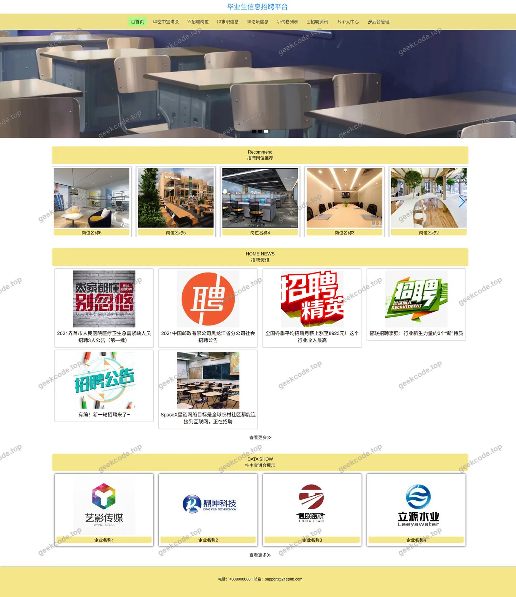</a>

<h4>前台注册页</h4>

<a href="https://geekcode.top/archives/%E6%AF%95%E4%B8%9A%E7%94%9F%E4%BF%A1%E6%81%AF%E6%8B%9B%E8%81%98%E5%B9%B3%E5%8F%B0?utm_source=github" title="查看完整源码">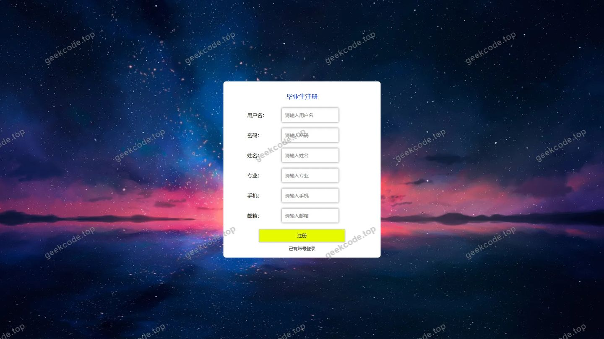</a>

<h4>前台登录页</h4>

<h4>前台-论坛信息列表</h4>

<a href="https://geekcode.top/archives/%E6%AF%95%E4%B8%9A%E7%94%9F%E4%BF%A1%E6%81%AF%E6%8B%9B%E8%81%98%E5%B9%B3%E5%8F%B0?utm_source=github" title="查看完整源码">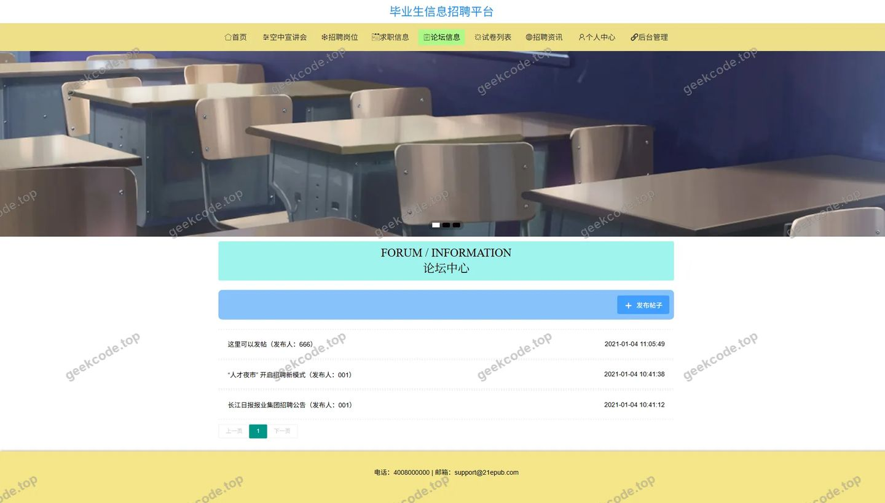</a>

<h4>前台-空中宣讲会列表</h4>

<a href="https://geekcode.top/archives/%E6%AF%95%E4%B8%9A%E7%94%9F%E4%BF%A1%E6%81%AF%E6%8B%9B%E8%81%98%E5%B9%B3%E5%8F%B0?utm_source=github" title="查看完整源码">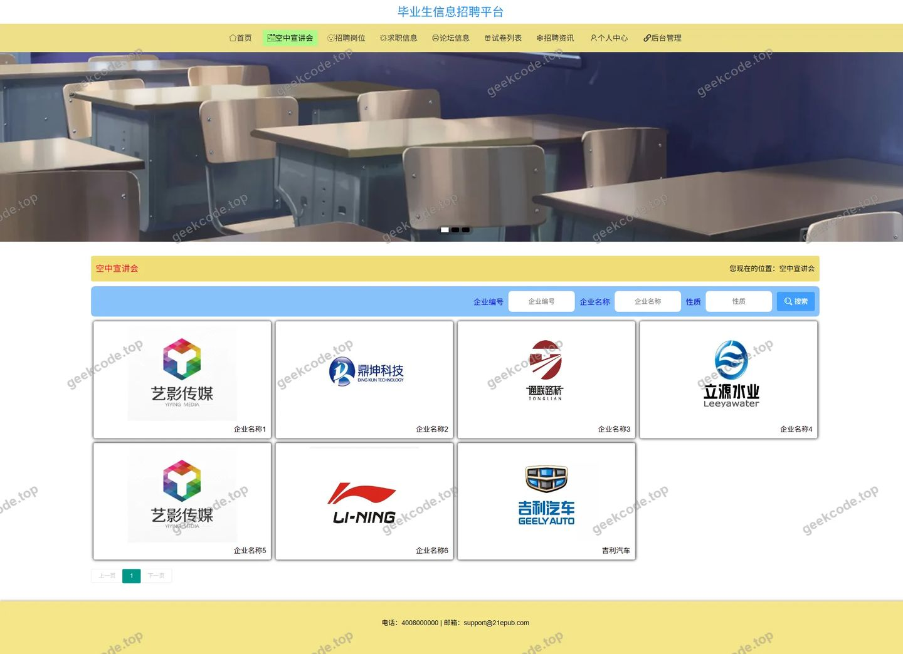</a>

<h4>前台-招聘资讯列表</h4>

<a href="https://geekcode.top/archives/%E6%AF%95%E4%B8%9A%E7%94%9F%E4%BF%A1%E6%81%AF%E6%8B%9B%E8%81%98%E5%B9%B3%E5%8F%B0?utm_source=github" title="查看完整源码">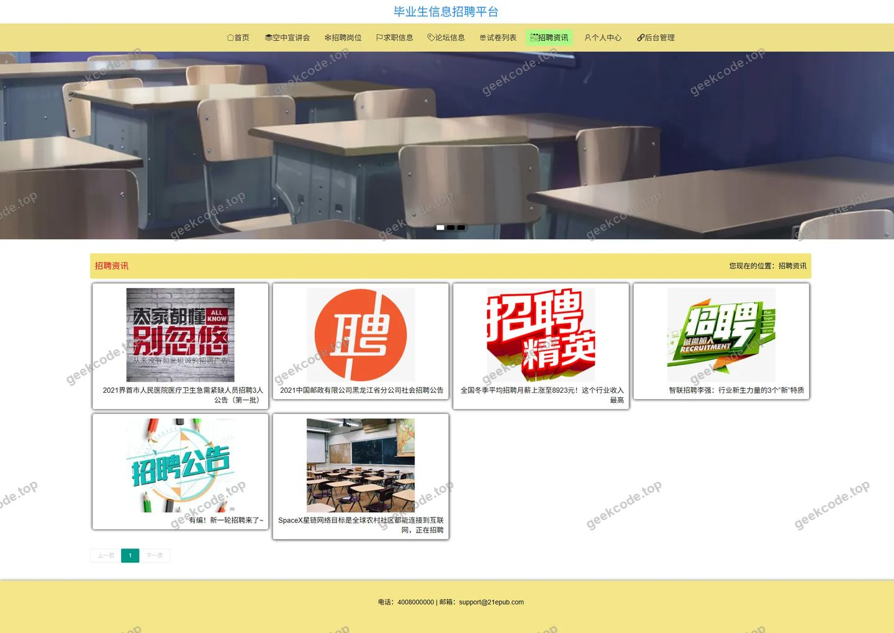</a>

<h4>前台-招聘岗位列表</h4>

<a href="https://geekcode.top/archives/%E6%AF%95%E4%B8%9A%E7%94%9F%E4%BF%A1%E6%81%AF%E6%8B%9B%E8%81%98%E5%B9%B3%E5%8F%B0?utm_source=github" title="查看完整源码">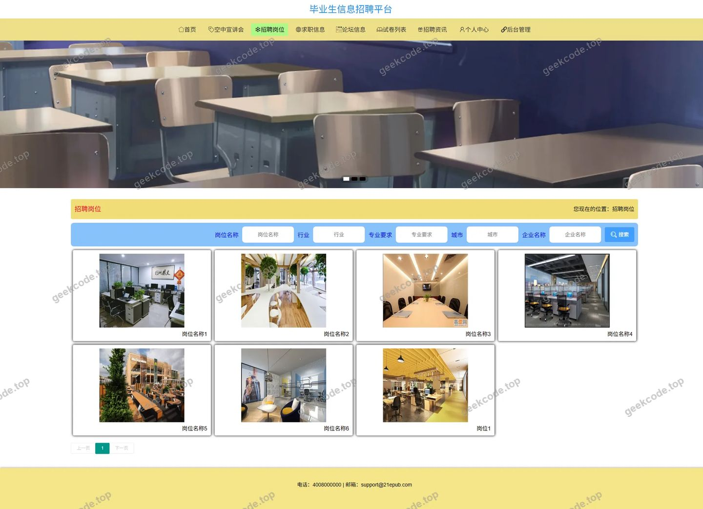</a>

<h4>前台-空中宣讲会评论列表</h4>

<h4>前台-求职信息评论列表</h4>

<a href="https://geekcode.top/archives/%E6%AF%95%E4%B8%9A%E7%94%9F%E4%BF%A1%E6%81%AF%E6%8B%9B%E8%81%98%E5%B9%B3%E5%8F%B0?utm_source=github" title="查看完整源码">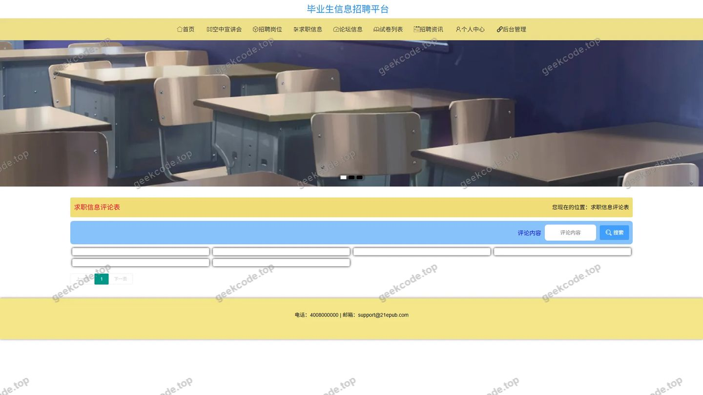</a>

<h4>前台-招聘岗位评论列表</h4>

<a href="https://geekcode.top/archives/%E6%AF%95%E4%B8%9A%E7%94%9F%E4%BF%A1%E6%81%AF%E6%8B%9B%E8%81%98%E5%B9%B3%E5%8F%B0?utm_source=github" title="查看完整源码">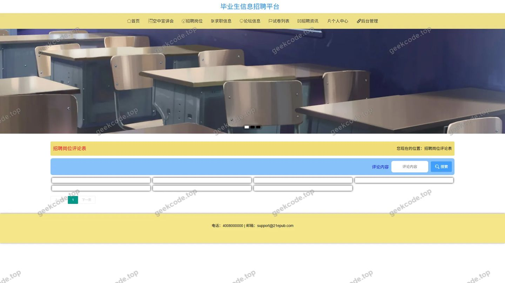</a>

<h4>前台-考试不合格记录</h4>

<a href="https://geekcode.top/archives/%E6%AF%95%E4%B8%9A%E7%94%9F%E4%BF%A1%E6%81%AF%E6%8B%9B%E8%81%98%E5%B9%B3%E5%8F%B0?utm_source=github" title="查看完整源码">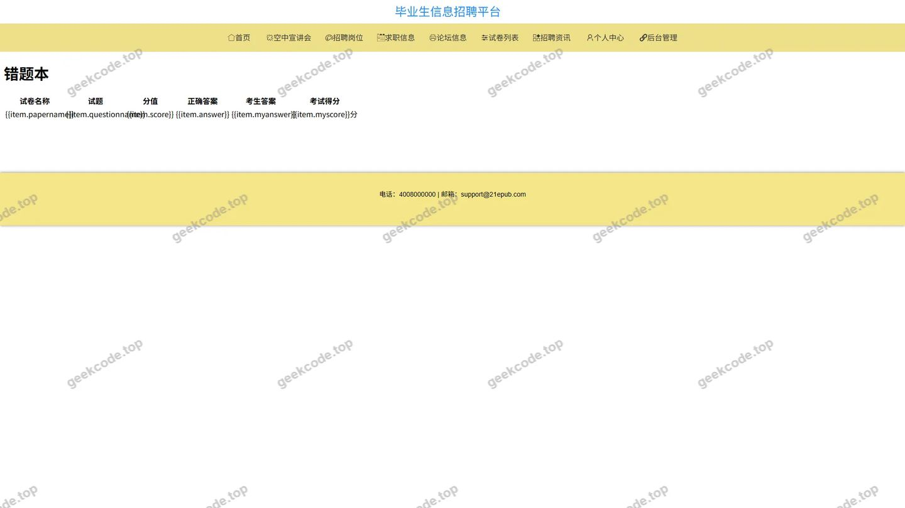</a>

<h4>前台个人中心</h4>

<a href="https://geekcode.top/archives/%E6%AF%95%E4%B8%9A%E7%94%9F%E4%BF%A1%E6%81%AF%E6%8B%9B%E8%81%98%E5%B9%B3%E5%8F%B0?utm_source=github" title="查看完整源码">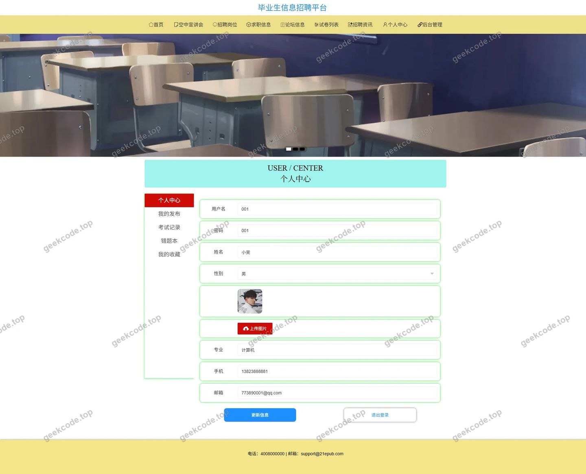</a>

<h4>前台-试卷列表列表</h4>

<a href="https://geekcode.top/archives/%E6%AF%95%E4%B8%9A%E7%94%9F%E4%BF%A1%E6%81%AF%E6%8B%9B%E8%81%98%E5%B9%B3%E5%8F%B0?utm_source=github" title="查看完整源码">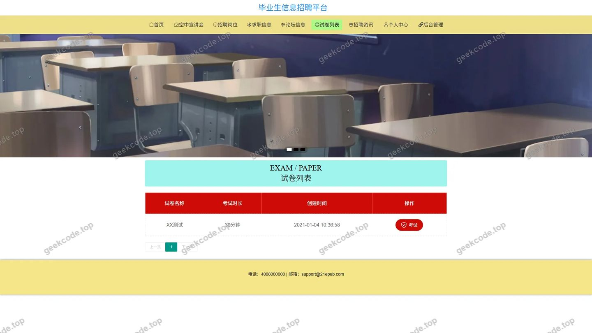</a>

<h4>前台-考试记录列表</h4>

<a href="https://geekcode.top/archives/%E6%AF%95%E4%B8%9A%E7%94%9F%E4%BF%A1%E6%81%AF%E6%8B%9B%E8%81%98%E5%B9%B3%E5%8F%B0?utm_source=github" title="查看完整源码">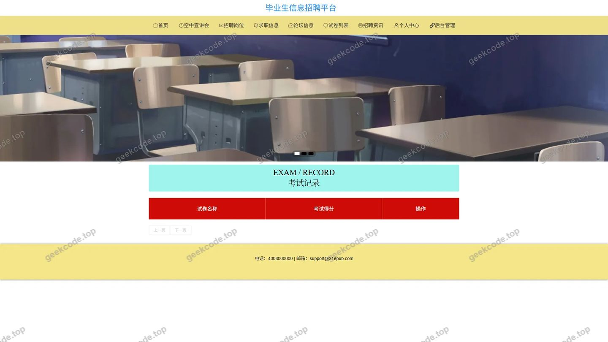</a>

<h4>前台-求职信息列表</h4>

<a href="https://geekcode.top/archives/%E6%AF%95%E4%B8%9A%E7%94%9F%E4%BF%A1%E6%81%AF%E6%8B%9B%E8%81%98%E5%B9%B3%E5%8F%B0?utm_source=github" title="查看完整源码">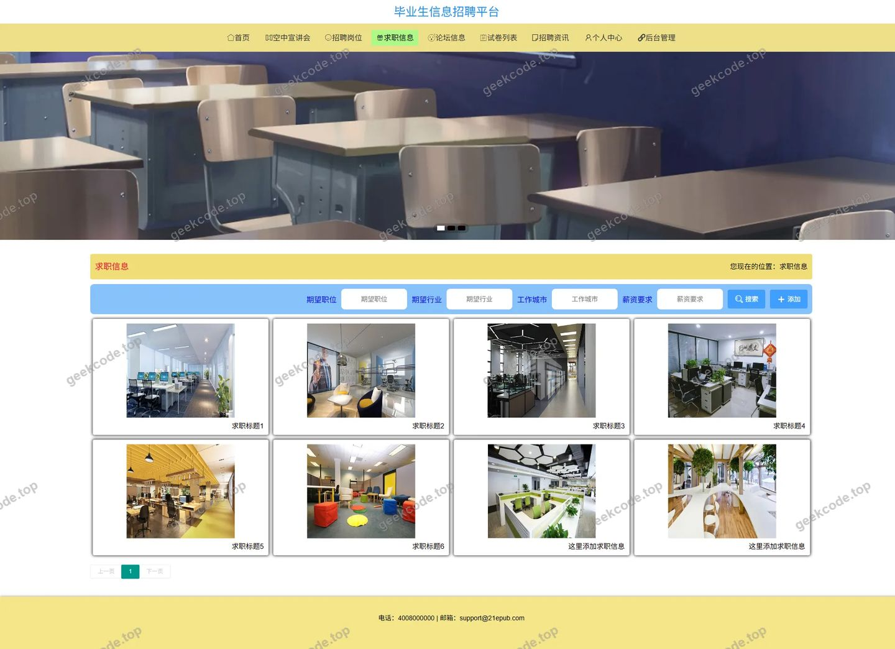</a>

<h4>前台-我的收藏列表</h4>

<a href="https://geekcode.top/archives/%E6%AF%95%E4%B8%9A%E7%94%9F%E4%BF%A1%E6%81%AF%E6%8B%9B%E8%81%98%E5%B9%B3%E5%8F%B0?utm_source=github" title="查看完整源码">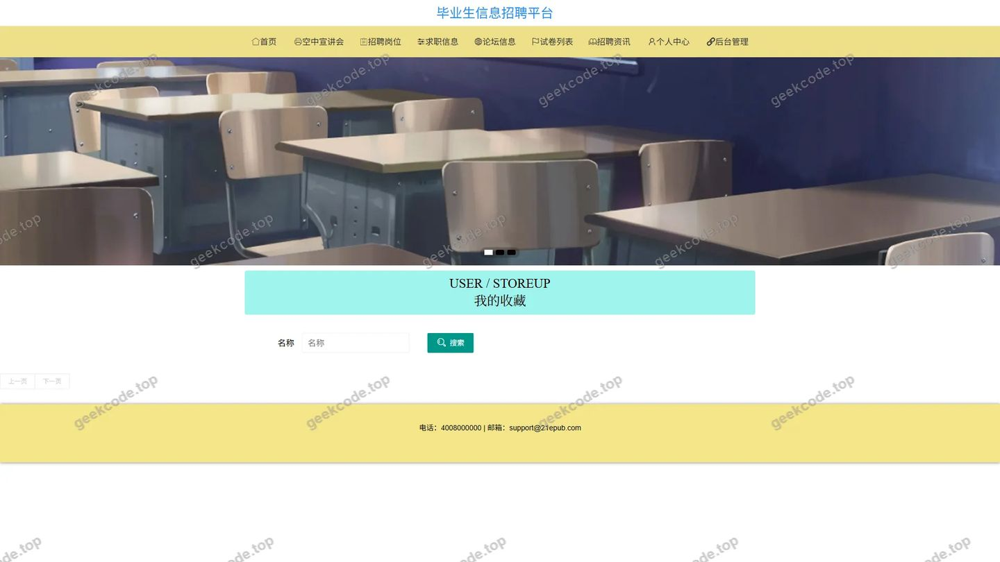</a>

<h4>前台-考试记录-详情</h4>

<a href="https://geekcode.top/archives/%E6%AF%95%E4%B8%9A%E7%94%9F%E4%BF%A1%E6%81%AF%E6%8B%9B%E8%81%98%E5%B9%B3%E5%8F%B0?utm_source=github" title="查看完整源码">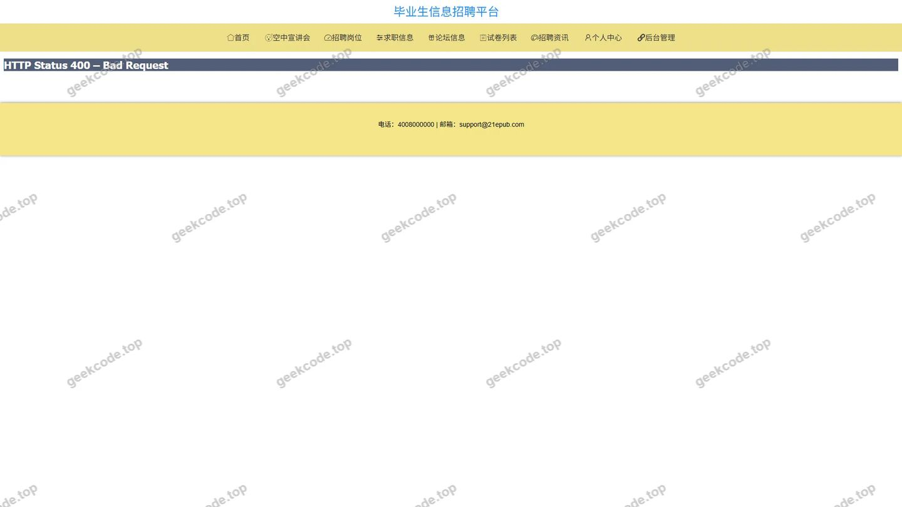</a>

<h4>前台-论坛信息-详情</h4>

<a href="https://geekcode.top/archives/%E6%AF%95%E4%B8%9A%E7%94%9F%E4%BF%A1%E6%81%AF%E6%8B%9B%E8%81%98%E5%B9%B3%E5%8F%B0?utm_source=github" title="查看完整源码">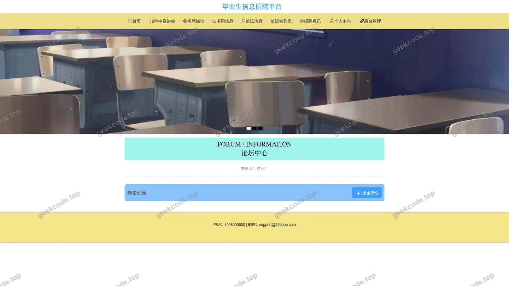</a>

<h4>前台-空中宣讲会-详情</h4>

<a href="https://geekcode.top/archives/%E6%AF%95%E4%B8%9A%E7%94%9F%E4%BF%A1%E6%81%AF%E6%8B%9B%E8%81%98%E5%B9%B3%E5%8F%B0?utm_source=github" title="查看完整源码">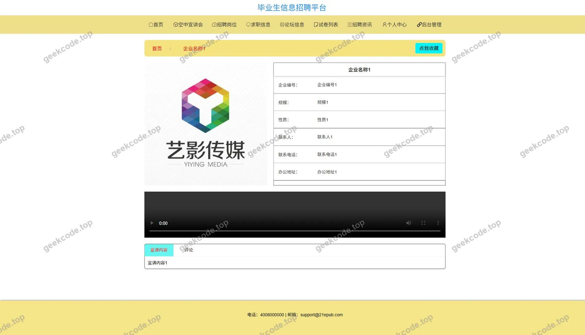</a>

<h4>前台-招聘资讯-详情</h4>

<a href="https://geekcode.top/archives/%E6%AF%95%E4%B8%9A%E7%94%9F%E4%BF%A1%E6%81%AF%E6%8B%9B%E8%81%98%E5%B9%B3%E5%8F%B0?utm_source=github" title="查看完整源码">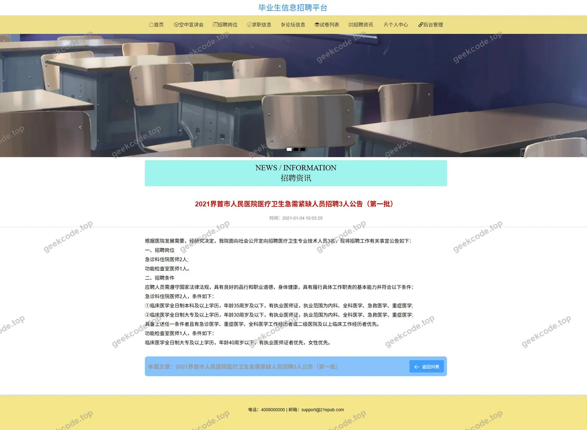</a>

<h4>前台-求职信息-详情</h4>

<a href="https://geekcode.top/archives/%E6%AF%95%E4%B8%9A%E7%94%9F%E4%BF%A1%E6%81%AF%E6%8B%9B%E8%81%98%E5%B9%B3%E5%8F%B0?utm_source=github" title="查看完整源码">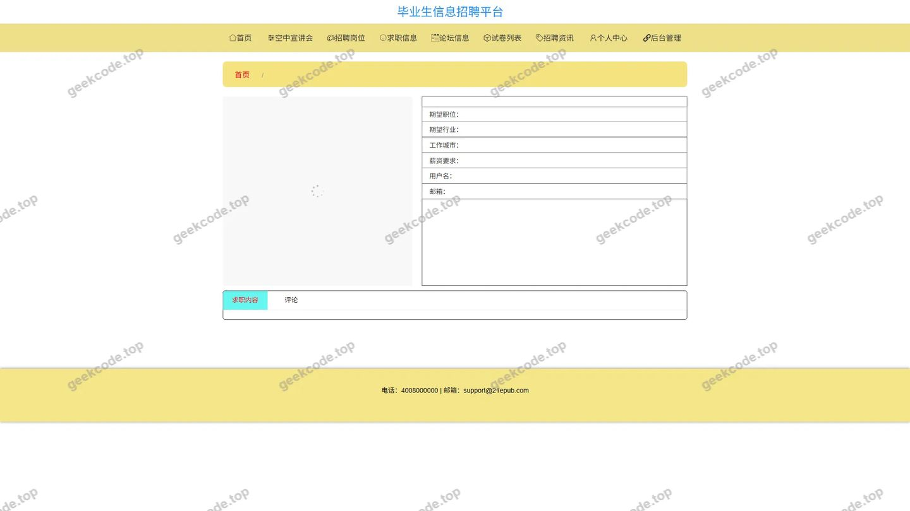</a>

<h4>前台-招聘岗位-详情</h4>

<a href="https://geekcode.top/archives/%E6%AF%95%E4%B8%9A%E7%94%9F%E4%BF%A1%E6%81%AF%E6%8B%9B%E8%81%98%E5%B9%B3%E5%8F%B0?utm_source=github" title="查看完整源码">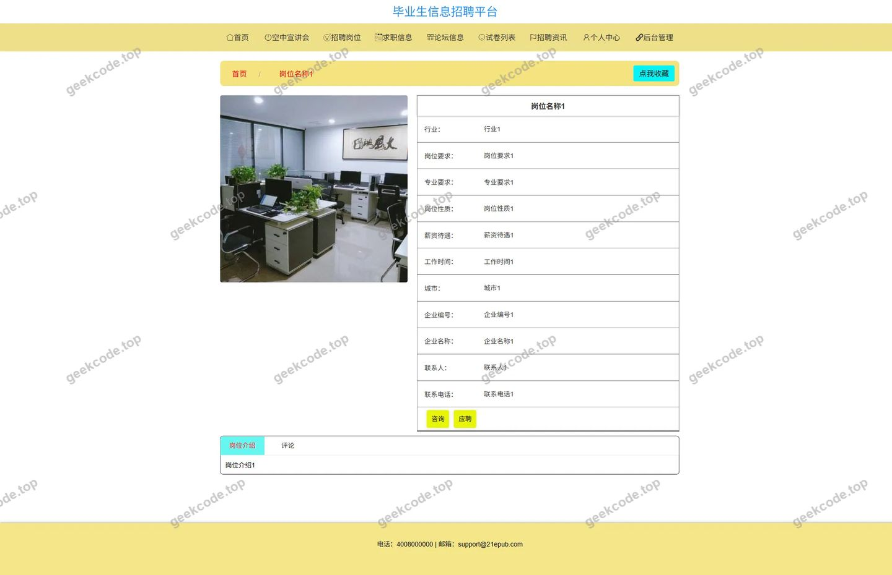</a>

<h4>前台-岗位应聘列表</h4>

<a href="https://geekcode.top/archives/%E6%AF%95%E4%B8%9A%E7%94%9F%E4%BF%A1%E6%81%AF%E6%8B%9B%E8%81%98%E5%B9%B3%E5%8F%B0?utm_source=github" title="查看完整源码">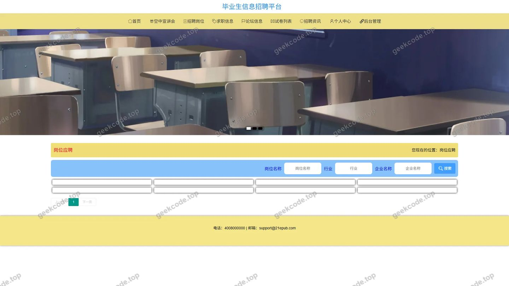</a>

<h4>前台-个人简历列表</h4>

<a href="https://geekcode.top/archives/%E6%AF%95%E4%B8%9A%E7%94%9F%E4%BF%A1%E6%81%AF%E6%8B%9B%E8%81%98%E5%B9%B3%E5%8F%B0?utm_source=github" title="查看完整源码">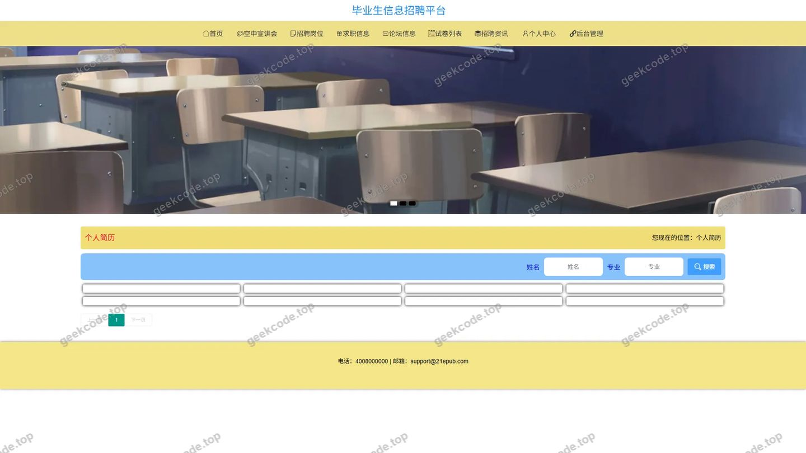</a>

<h3>后台管理端</h3>
<h4>后台-毕业生</h4>

<a href="https://geekcode.top/archives/%E6%AF%95%E4%B8%9A%E7%94%9F%E4%BF%A1%E6%81%AF%E6%8B%9B%E8%81%98%E5%B9%B3%E5%8F%B0?utm_source=github" title="查看完整源码">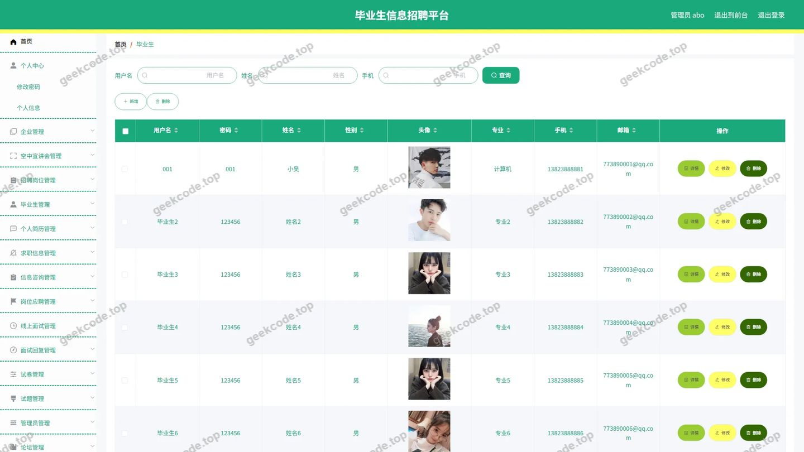</a>

<h4>后台-空中宣讲会评论</h4>

<a href="https://geekcode.top/archives/%E6%AF%95%E4%B8%9A%E7%94%9F%E4%BF%A1%E6%81%AF%E6%8B%9B%E8%81%98%E5%B9%B3%E5%8F%B0?utm_source=github" title="查看完整源码">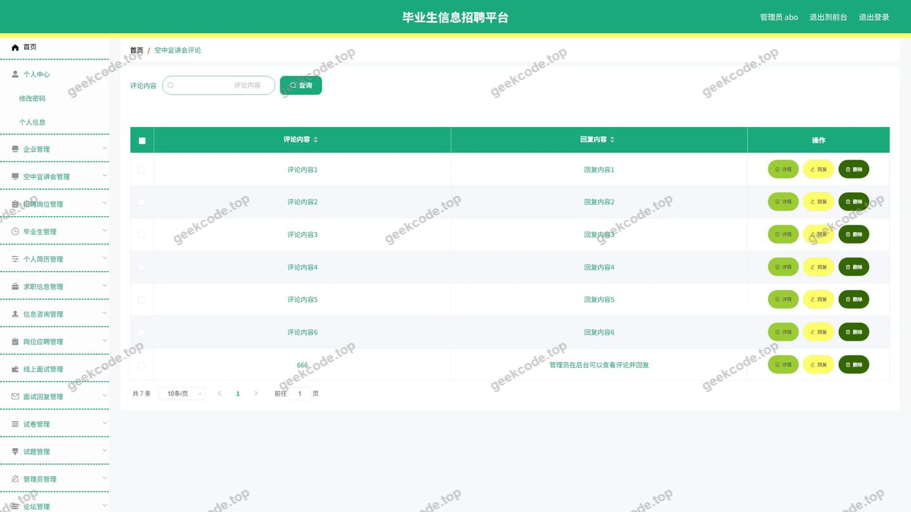</a>

<h4>后台-求职信息评论</h4>

<a href="https://geekcode.top/archives/%E6%AF%95%E4%B8%9A%E7%94%9F%E4%BF%A1%E6%81%AF%E6%8B%9B%E8%81%98%E5%B9%B3%E5%8F%B0?utm_source=github" title="查看完整源码">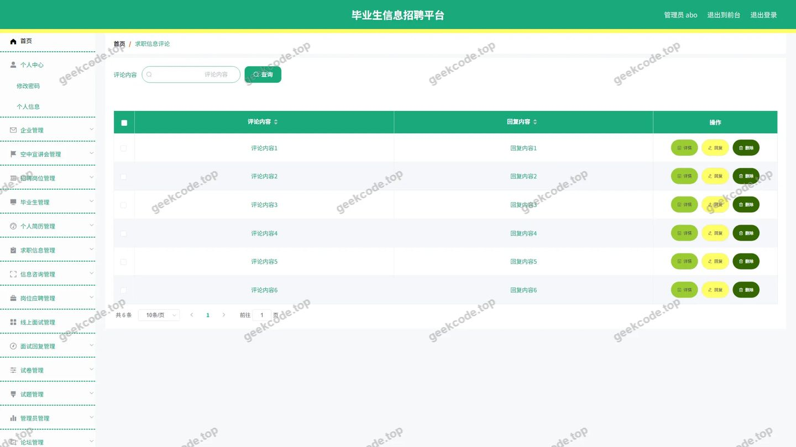</a>

<h4>后台-招聘岗位评论</h4>

<a href="https://geekcode.top/archives/%E6%AF%95%E4%B8%9A%E7%94%9F%E4%BF%A1%E6%81%AF%E6%8B%9B%E8%81%98%E5%B9%B3%E5%8F%B0?utm_source=github" title="查看完整源码">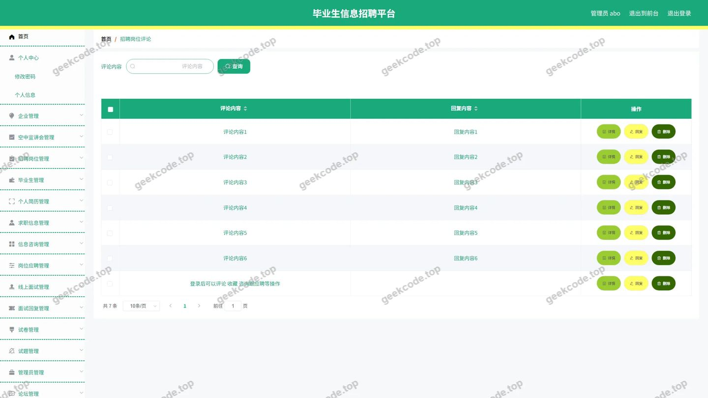</a>

<h4>后台-考试不合格记录</h4>

<a href="https://geekcode.top/archives/%E6%AF%95%E4%B8%9A%E7%94%9F%E4%BF%A1%E6%81%AF%E6%8B%9B%E8%81%98%E5%B9%B3%E5%8F%B0?utm_source=github" title="查看完整源码">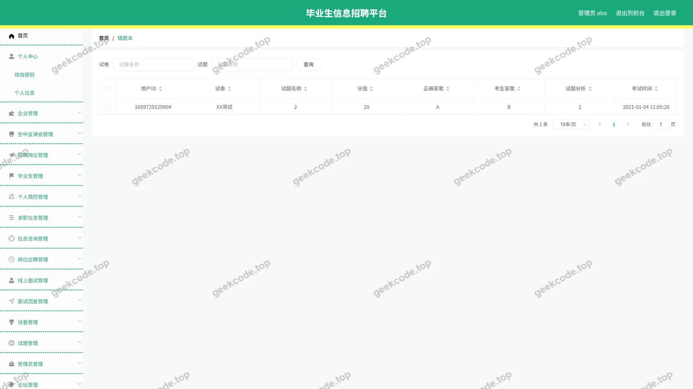</a>

<h4>后台-试卷</h4>

<a href="https://geekcode.top/archives/%E6%AF%95%E4%B8%9A%E7%94%9F%E4%BF%A1%E6%81%AF%E6%8B%9B%E8%81%98%E5%B9%B3%E5%8F%B0?utm_source=github" title="查看完整源码">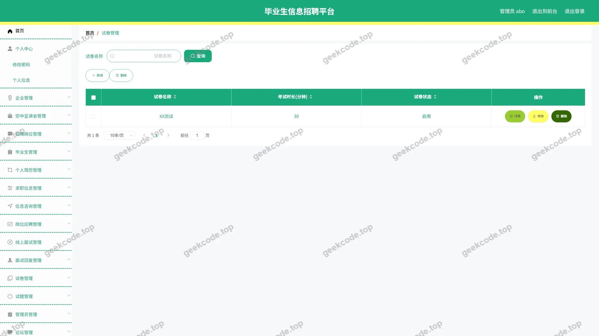</a>

<h4>后台-试卷列表</h4>

<a href="https://geekcode.top/archives/%E6%AF%95%E4%B8%9A%E7%94%9F%E4%BF%A1%E6%81%AF%E6%8B%9B%E8%81%98%E5%B9%B3%E5%8F%B0?utm_source=github" title="查看完整源码">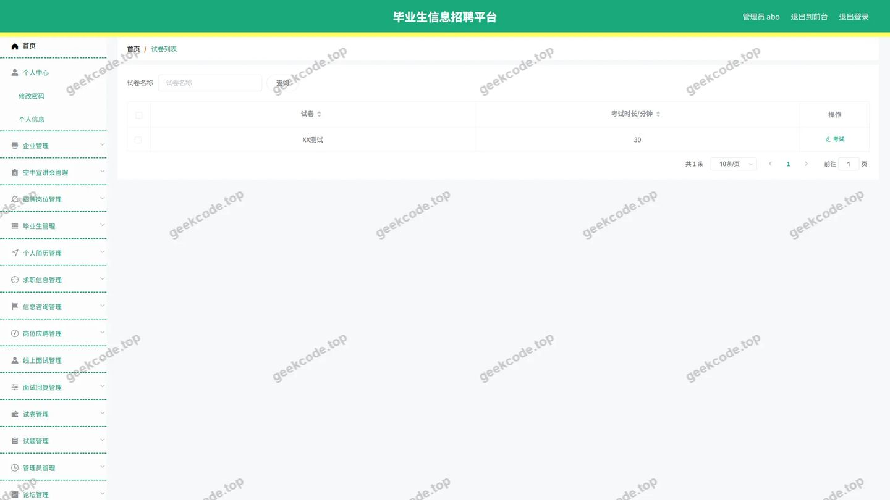</a>

<h4>后台-试题</h4>

<a href="https://geekcode.top/archives/%E6%AF%95%E4%B8%9A%E7%94%9F%E4%BF%A1%E6%81%AF%E6%8B%9B%E8%81%98%E5%B9%B3%E5%8F%B0?utm_source=github" title="查看完整源码">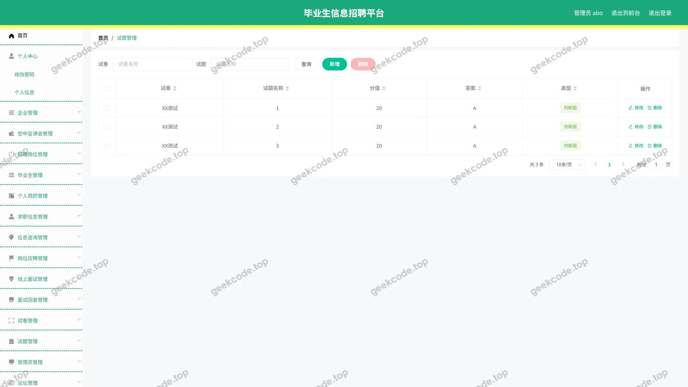</a>

<h4>后台-论坛</h4>

<a href="https://geekcode.top/archives/%E6%AF%95%E4%B8%9A%E7%94%9F%E4%BF%A1%E6%81%AF%E6%8B%9B%E8%81%98%E5%B9%B3%E5%8F%B0?utm_source=github" title="查看完整源码">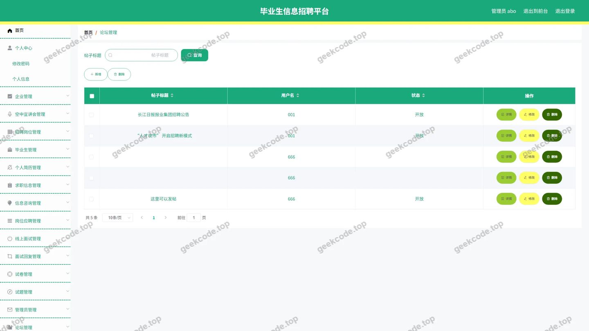</a>

<h4>后台-岗位应聘</h4>

<a href="https://geekcode.top/archives/%E6%AF%95%E4%B8%9A%E7%94%9F%E4%BF%A1%E6%81%AF%E6%8B%9B%E8%81%98%E5%B9%B3%E5%8F%B0?utm_source=github" title="查看完整源码">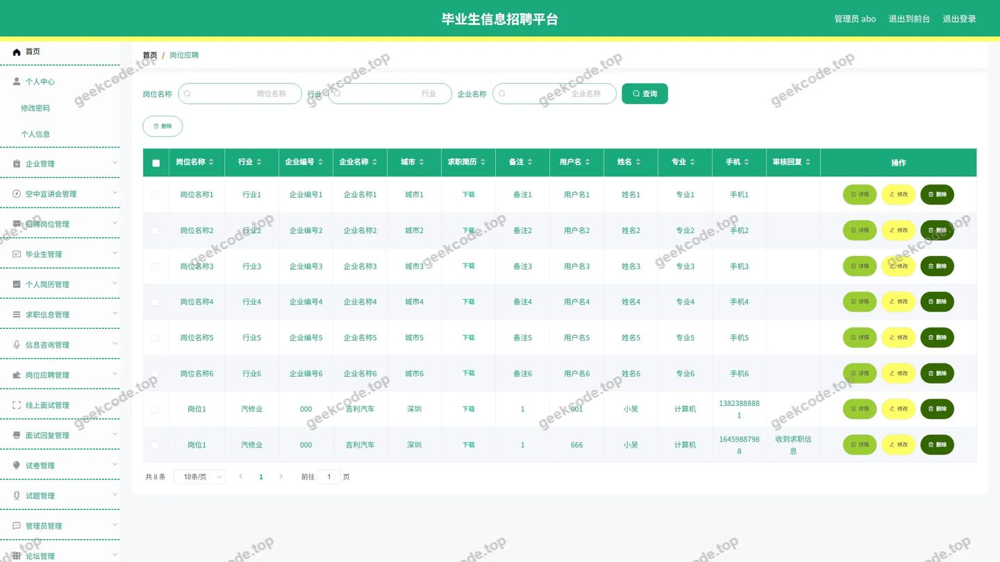</a>

<h4>后台-个人简历</h4>

<a href="https://geekcode.top/archives/%E6%AF%95%E4%B8%9A%E7%94%9F%E4%BF%A1%E6%81%AF%E6%8B%9B%E8%81%98%E5%B9%B3%E5%8F%B0?utm_source=github" title="查看完整源码">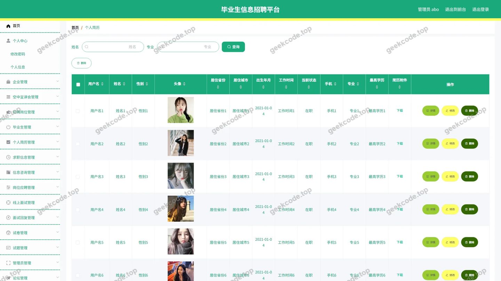</a>

<h4>后台首页</h4>

<a href="https://geekcode.top/archives/%E6%AF%95%E4%B8%9A%E7%94%9F%E4%BF%A1%E6%81%AF%E6%8B%9B%E8%81%98%E5%B9%B3%E5%8F%B0?utm_source=github" title="查看完整源码">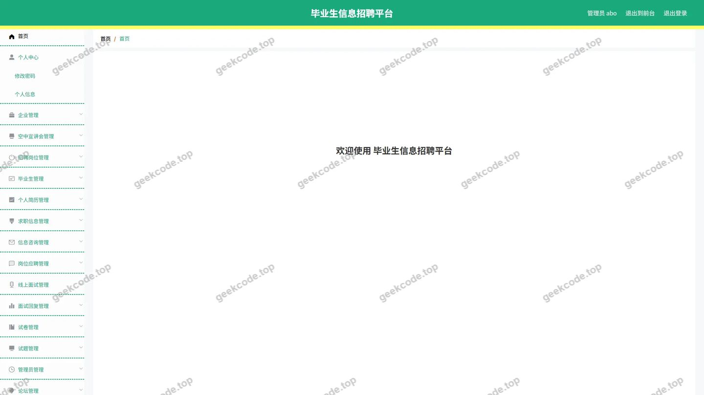</a>

<h4>后台-登录</h4>

<h4>后台-面试回复</h4>

<a href="https://geekcode.top/archives/%E6%AF%95%E4%B8%9A%E7%94%9F%E4%BF%A1%E6%81%AF%E6%8B%9B%E8%81%98%E5%B9%B3%E5%8F%B0?utm_source=github" title="查看完整源码">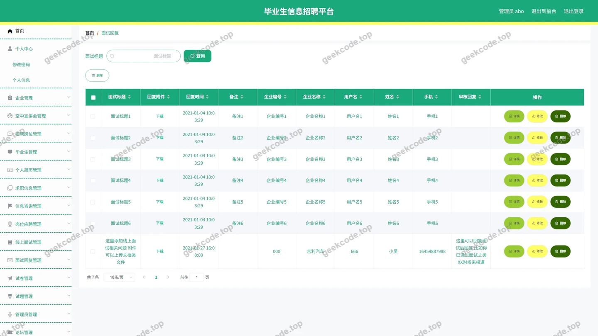</a>

<h4>后台-公告信息</h4>

<a href="https://geekcode.top/archives/%E6%AF%95%E4%B8%9A%E7%94%9F%E4%BF%A1%E6%81%AF%E6%8B%9B%E8%81%98%E5%B9%B3%E5%8F%B0?utm_source=github" title="查看完整源码">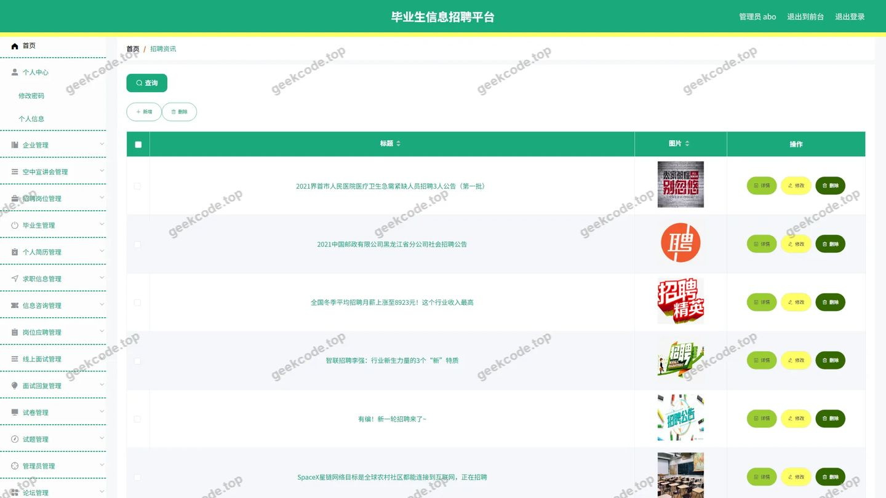</a>

<h4>后台-求职信息</h4>

<a href="https://geekcode.top/archives/%E6%AF%95%E4%B8%9A%E7%94%9F%E4%BF%A1%E6%81%AF%E6%8B%9B%E8%81%98%E5%B9%B3%E5%8F%B0?utm_source=github" title="查看完整源码">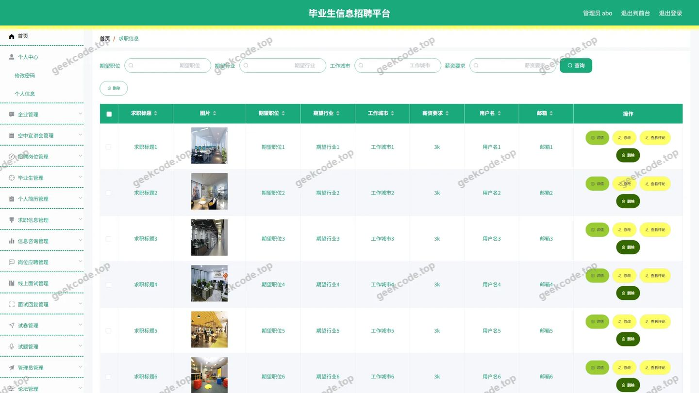</a>

<h4>后台-企业</h4>

<a href="https://geekcode.top/archives/%E6%AF%95%E4%B8%9A%E7%94%9F%E4%BF%A1%E6%81%AF%E6%8B%9B%E8%81%98%E5%B9%B3%E5%8F%B0?utm_source=github" title="查看完整源码">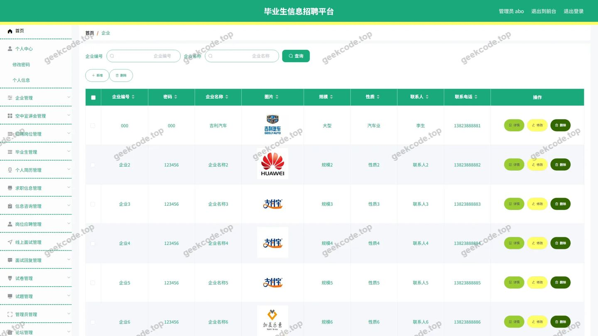</a>

<h4>后台-收藏</h4>

<a href="https://geekcode.top/archives/%E6%AF%95%E4%B8%9A%E7%94%9F%E4%BF%A1%E6%81%AF%E6%8B%9B%E8%81%98%E5%B9%B3%E5%8F%B0?utm_source=github" title="查看完整源码">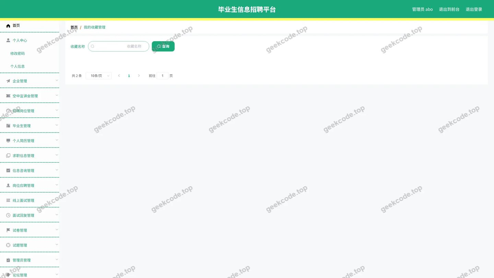</a>

<h4>后台-线上面试</h4>

<a href="https://geekcode.top/archives/%E6%AF%95%E4%B8%9A%E7%94%9F%E4%BF%A1%E6%81%AF%E6%8B%9B%E8%81%98%E5%B9%B3%E5%8F%B0?utm_source=github" title="查看完整源码">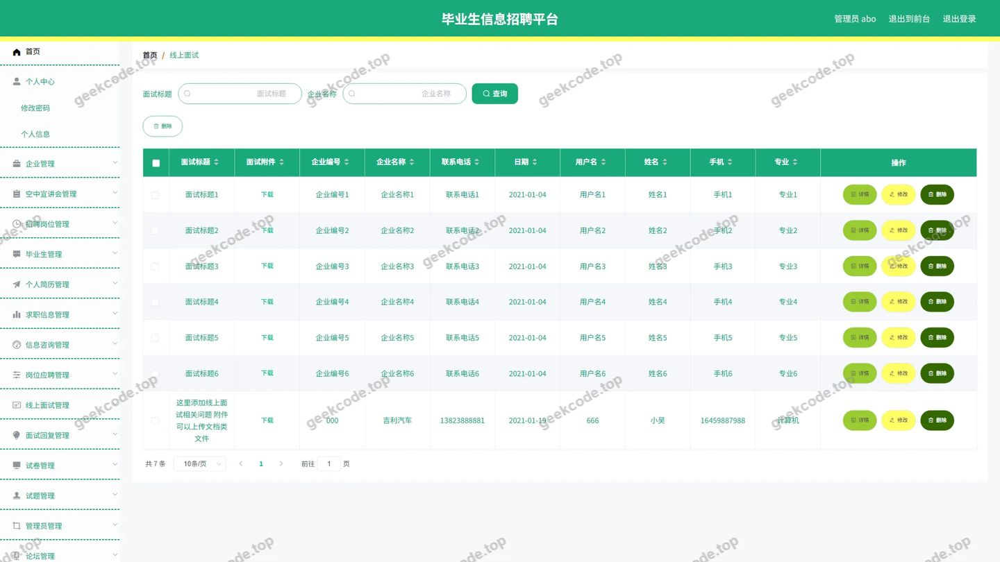</a>

<h4>后台-信息咨询</h4>

<a href="https://geekcode.top/archives/%E6%AF%95%E4%B8%9A%E7%94%9F%E4%BF%A1%E6%81%AF%E6%8B%9B%E8%81%98%E5%B9%B3%E5%8F%B0?utm_source=github" title="查看完整源码">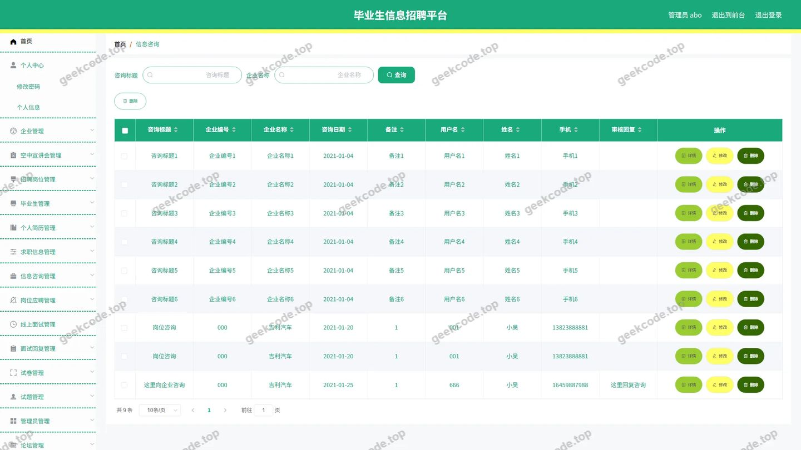</a>

<h4>后台-招聘岗位</h4>

<a href="https://geekcode.top/archives/%E6%AF%95%E4%B8%9A%E7%94%9F%E4%BF%A1%E6%81%AF%E6%8B%9B%E8%81%98%E5%B9%B3%E5%8F%B0?utm_source=github" title="查看完整源码">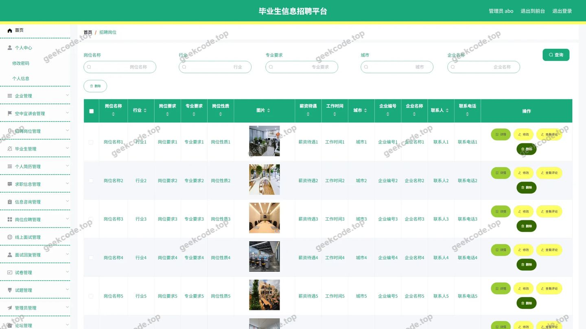</a>

---

## 获取完整源码

| 项目 | 说明 |
| --- | --- |
| 项目名 | 毕业生信息招聘平台 |
| 运行截图 | 本文 45 张（站点带水印原图，仓库 `images/` 目录） |
| 完整源码 | [https://geekcode.top/archives/%E6%AF%95%E4%B8%9A%E7%94%9F%E4%BF%A1%E6%81%AF%E6%8B%9B%E8%81%98%E5%B9%B3%E5%8F%B0?utm_source=github](https://geekcode.top/archives/%E6%AF%95%E4%B8%9A%E7%94%9F%E4%BF%A1%E6%81%AF%E6%8B%9B%E8%81%98%E5%B9%B3%E5%8F%B0?utm_source=github) |
| 咨询微信 | **ir9372**（备注：jingpin-yuanma） |
| 更多项目 | [极客代码 geekcode.top](https://geekcode.top/?utm_source=github) |

> 需要源码、部署、改配置、跑不起来等问题，加微信 ir9372 沟通，说明项目名即可。
